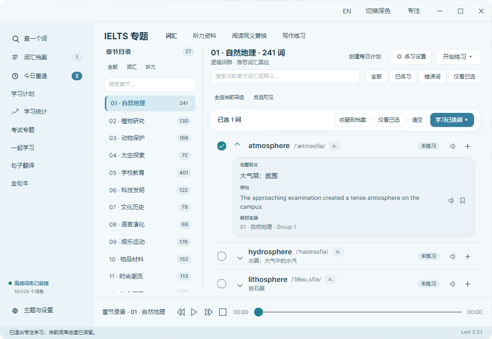
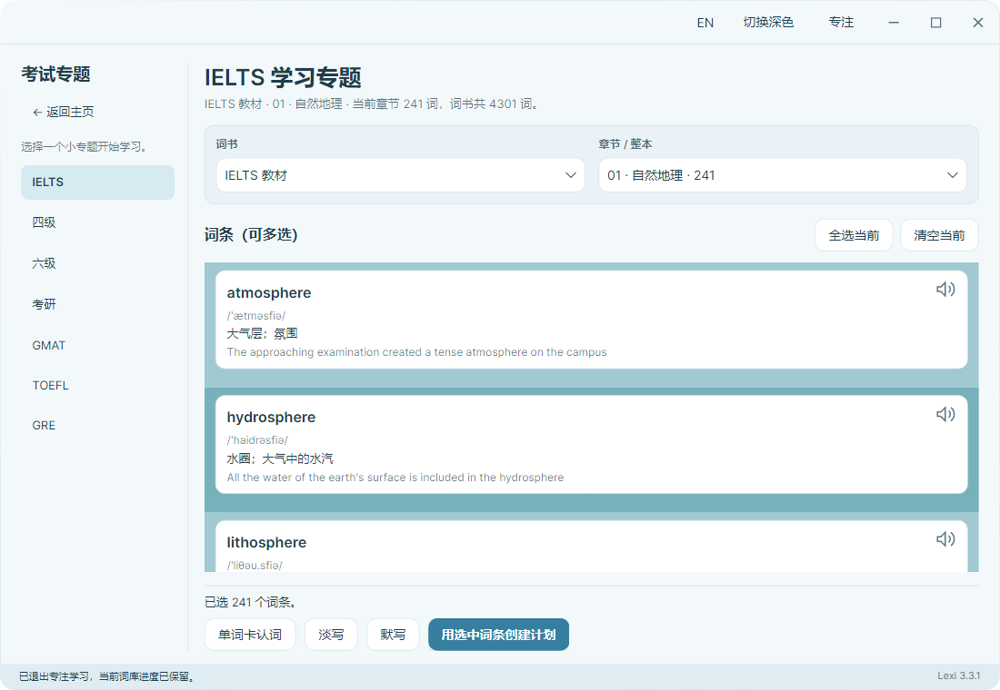
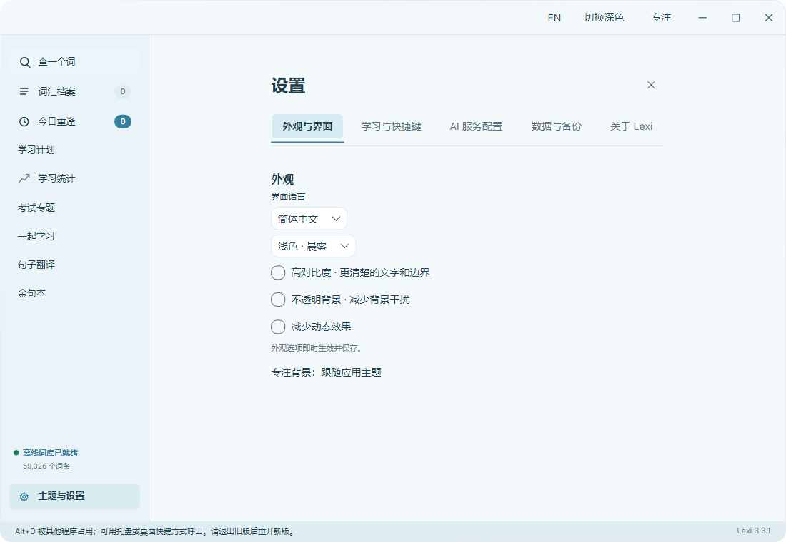
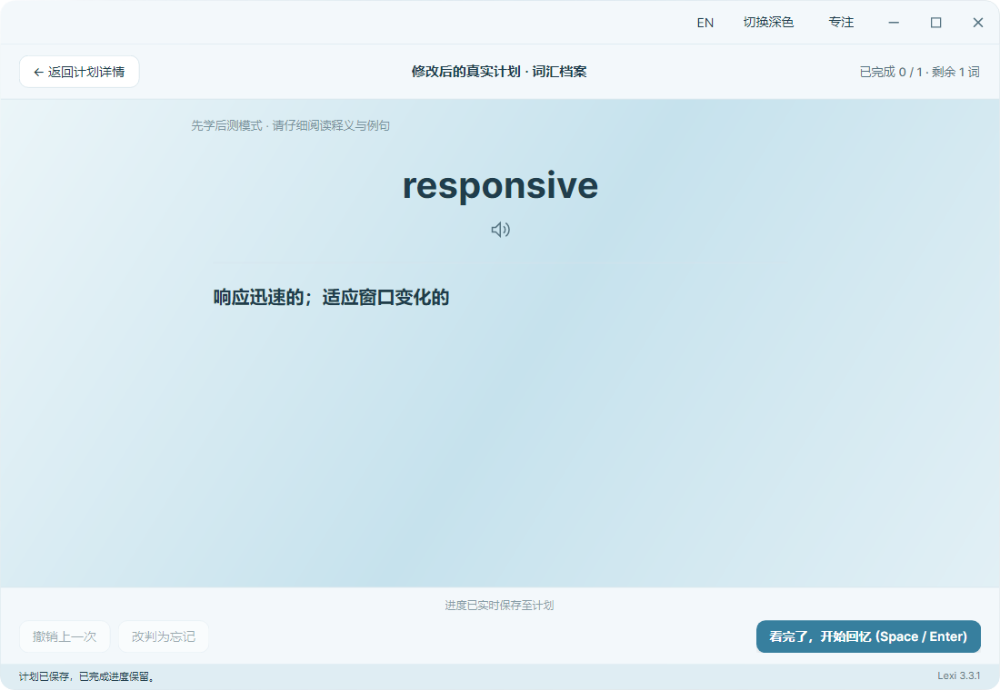
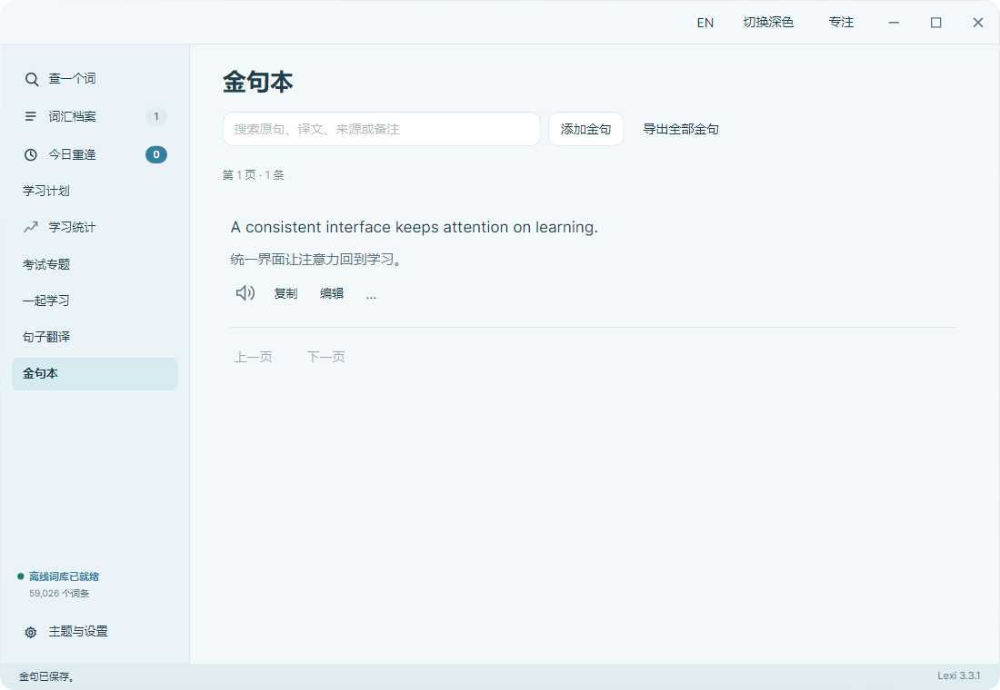
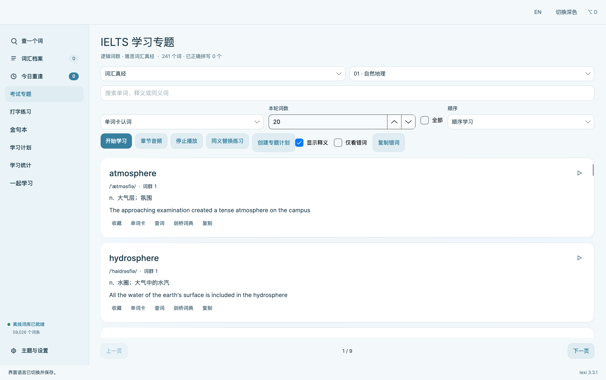
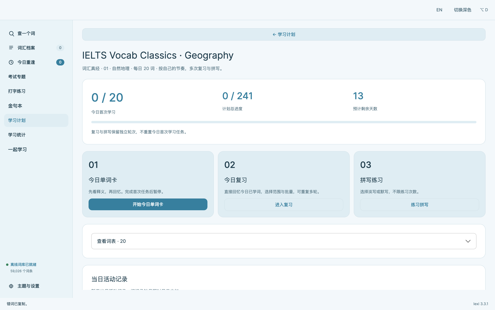
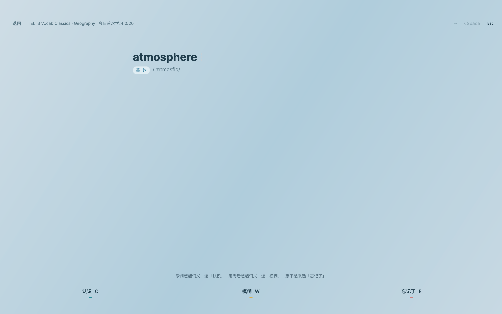
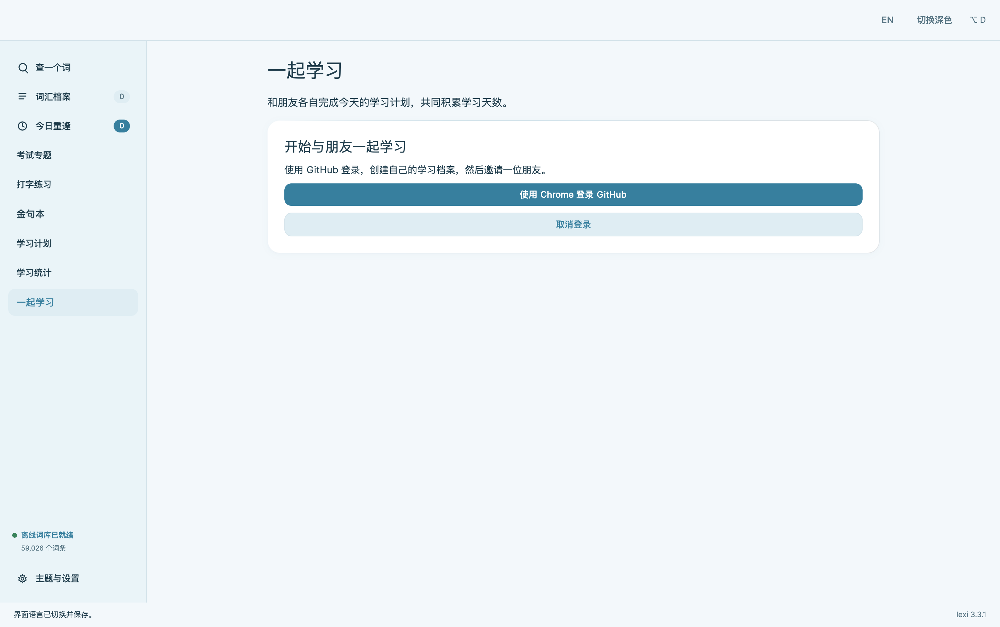
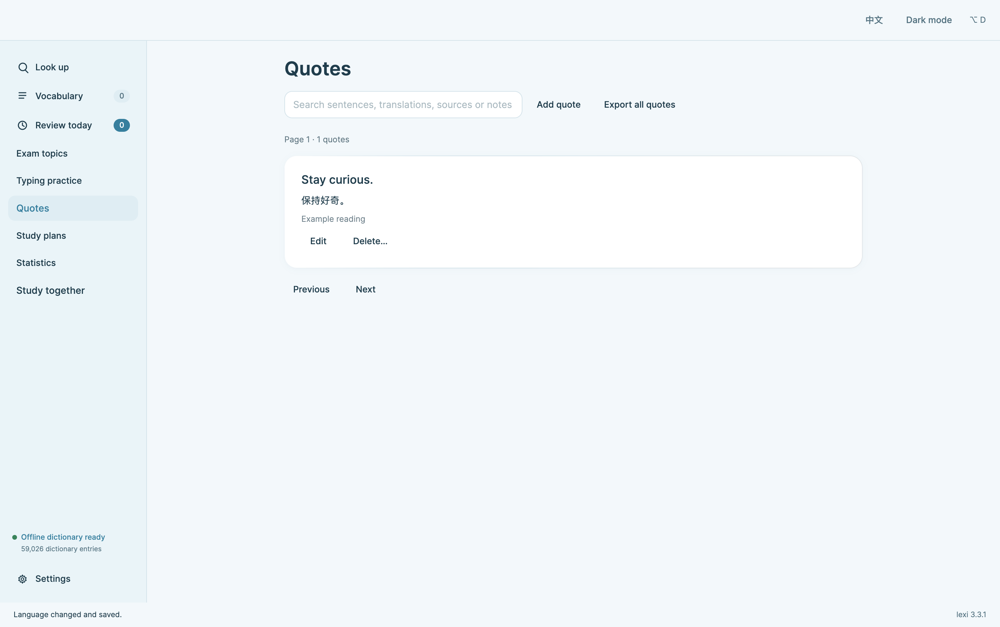

<div align="center">

# Lexi

**本地优先的英语词汇、记忆与阅读工具**

Windows x64 · macOS Apple Silicon · 离线词典 · FSRS-6 · 考试专题 · 学习计划

[](windows/README.md)
[](macos/README.md)
[](android/README.md)
[](LICENSE)

[下载 3.3.1](https://github.com/Cofran-77/lexi/releases/tag/v3.3.1-cross-platform) ·
[构建说明](docs/BUILDING.md) ·
[更新日志](CHANGELOG.md) ·
[隐私边界](docs/PRIVACY.md) ·
[问题反馈](https://github.com/Cofran-77/lexi/issues)

</div>

Lexi 把查词、词汇档案、每日计划与长期复习放在同一个桌面应用里。核心功能在本机运行：离线词典不需要账号，个人词库、学习记录、金句和记忆状态默认不离开设备。可选登录只用于「一起学习」好友摘要同步。

本次跨平台 Release 同时提供 Windows 3.3.1 和 macOS 3.3.1。安装包作为 GitHub Release 资产分发，源码位于 `windows/` 与 `macos/`。

## 下载

| 平台 | 系统要求 | 安装包 | 校验 |
| --- | --- | --- | --- |
| Windows | Windows 10 / 11，x64 | [Lexi-3.3.1-x64-setup.exe](https://github.com/Cofran-77/lexi/releases/download/v3.3.1-cross-platform/Lexi-3.3.1-x64-setup.exe) | [SHA256](https://github.com/Cofran-77/lexi/releases/download/v3.3.1-cross-platform/Lexi-3.3.1-x64-setup.exe.sha256) |
| macOS | Apple Silicon，macOS 12+ | [Lexi-3.3.1-macOS-arm64.dmg](https://github.com/Cofran-77/lexi/releases/download/v3.3.1-cross-platform/Lexi-3.3.1-macOS-arm64.dmg) | [SHA256](https://github.com/Cofran-77/lexi/releases/download/v3.3.1-cross-platform/Lexi-3.3.1-macOS-arm64.dmg.sha256) |

Windows SHA256：

```text
30be541a845f3f42418886a15e9016e3685cdaf250b31f5392fd7607863590d6
```

macOS SHA256：

```text
72df2d153e31e6c6a2cc4abd61f9420db04ad1c84d7bdefafd9d86f55642a354
```

Windows 安装包未使用商业代码签名证书，系统可能显示“未知发布者”。macOS DMG 使用项目自有签名，未使用 Apple Developer ID，也未经过 Apple 公证。首次打开前请核对来源与 SHA256，并按系统提示完成安全确认。

## 3.3.1 更新内容

- 扩展考试专题到 IELTS、CET-4、CET-6、考研、GMAT、TOEFL、GRE，并加入 20 本考试词书。
- 支持按词书、单元或选中词条建立每日计划；同一单词出现在不同词书时分别保存学习轮次。
- 新考试词条接入今日重逢、拼写、错词、学习统计与 FSRS-6 长期排期。
- 学习统计展示初学、复习、拼写时长、学习词数、连续天数、峰值和易忘词，并区分预测与已观察数据。
- 新增可选的「一起学习」：双人邀请、逐好友分享控制、共同学习日与预测曲线对照。
- 统一 Glacier Blue 视觉、双语界面、计划汇总、备份轮换与数据库加法迁移。
- 修复复习卡内部 ID 泄漏、评分后“下一词”或空格无响应，以及“忘记”后主操作不突出等问题。

完整说明见 [3.3.1 发布记录](docs/releases/v3.3.1-cross-platform.md) 与 [版本历史](docs/VERSION_HISTORY.md)。

## 核心能力

### 查词与词汇档案

- Windows 与 macOS 均内置 59,026 条 ECDICT 离线词典记录。
- 保存音标、释义、来源原句、备注、标签和可选 AI 内容。
- 支持词条编辑、筛选、批量管理、CSV / JSON 迁移与本地备份。
- Windows 支持全局快捷查词、文字选择、朗读、打印与导出；macOS 支持 `⌥D` 查词、`⌥A` 翻译与 `⌥S` 收藏金句。

### 学习与记忆

- 今日重逢、先回忆后揭晓、三按钮评分、轮内强化、改判与撤销。
- FSRS-6 根据每个词的历史计算长期复习间隔；数据不足时使用默认参数。
- 个人 FSRS 参数由本机 Rust 助手训练，Context 校正在本机运行并经过影子验证。
- 每日计划、淡写、默写、逐字反馈、自动发音、全局专注与可配置快捷键。
- 考试专题支持整本、单元或选中词条进入学习，词书身份彼此隔离。

### 本地优先与可选同步

- 离线查词、词库、计划、学习记录、金句、统计与 FSRS 不需要登录。
- Windows 默认数据目录为 `%LOCALAPPDATA%\Lexi`。
- macOS 默认数据目录为 `~/Library/Application Support/Lexi/`。
- AI 是可选能力，由用户配置自己的 OpenAI 风格接口；密钥分别保存在 Windows 受保护存储或 macOS 钥匙串。
- 「一起学习」需要 GitHub 登录，只同步账号资料、好友关系、当日达标及用户授权的统计摘要。完整词库、逐词历史、计划内容与个人记忆模型不上传。

公开源码和安装包不包含作者的个人词库、学习记录、登录 Cookie、Session、Token、API Key、签名私钥或本机代理配置。详见 [隐私说明](docs/PRIVACY.md) 和 [数据迁移](docs/DATA_AND_MIGRATION.md)。

## 界面预览

以下截图使用隔离演示数据，不读取个人词库、账号状态或通知。Windows 截图为 3.3.1 实际桌面界面。

| 查词与词汇档案 | IELTS 专题 |
| --- | --- |
|  |  |

| 设置与学习选项 | 全局专注学习 |
| --- | --- |
|  |  |

<div align="center">

</div>

macOS 截图来自 3.3.1 arm64 实际应用与隔离示例档案。

| 首页与离线查词 | 七大考试专题 |
| --- | --- |
|  |  |

| 学习计划 | 每日计划 |
| --- | --- |
|  |  |

| 单词回忆 | 忘记后的再次学习 |
| --- | --- |
|  |  |

| 学习统计 | 一起学习 |
| --- | --- |
|  |  |

<div align="center">

</div>

截图来源、分辨率与隔离数据说明见 [截图索引](docs/images/README.md)。

## 安装与升级

### Windows

1. 下载 EXE 和对应 `.sha256` 文件。
2. 在 PowerShell 中运行 `Get-FileHash .\Lexi-3.3.1-x64-setup.exe -Algorithm SHA256`，核对哈希。
3. 完全退出正在运行的 Lexi，再执行安装程序。
4. 如果需要保留旧版本，先备份 `%LOCALAPPDATA%\Lexi`；更新和卸载不会主动删除该目录，但用户仍应保有自己的备份。

安装包包含 .NET 运行环境、离线词典、FSRS 助手和当前专题资料，不需要额外安装 SDK。

### macOS

1. 下载 DMG 和对应 `.sha256` 文件。
2. 在终端运行 `shasum -a 256 -c Lexi-3.3.1-macOS-arm64.dmg.sha256`，确认输出为 `OK`。
3. 打开 DMG，将 `Lexi.app` 拖入“应用程序”，推出磁盘映像后启动。
4. 覆盖安装前先用 `⌘Q` 正常退出 Lexi。用户数据位于应用包外，升级不会替换词库、计划、学习轨迹和记忆状态。

DMG 中的卸载脚本默认只移除应用并保留用户数据；只有用户明确选择删除并再次确认时，才会清理 Lexi 自己的数据目录与钥匙串项目。

## 从源码构建

### Windows

需要 Windows 10 / 11 x64、.NET SDK 8、Rust 1.85+ 和 NSIS 3 Unicode。NuGet 与 Cargo 首次还原需要联网。

```powershell
git clone https://github.com/Cofran-77/lexi.git
cd lexi
cargo build --manifest-path windows/native/fsrs-optimizer/Cargo.toml --release --locked
dotnet build windows/Lexi.csproj -c Release
```

生成自包含安装包：

```powershell
pwsh -File windows/packaging/build-installer.ps1 `
  -Version 3.3.1 `
  -Dotnet <dotnet-path> `
  -Nsis <makensis-path>
```

Windows Git 源码依据 `.gitignore` 排除第三方 IELTS 书籍与音频；公开安装包包含发布方有权随包提供的资料。只有版权和使用条件允许时才应把完整资料加入本地构建。

### macOS

需要在 macOS 上使用 .NET SDK 8；完整打包还需要 Python 3.10+、Rust 和 macOS 磁盘映像工具。

```sh
cd macos
python3 scripts/verify_source_integrity.py
dotnet build lexi_avalonia/Lexi.csproj -c Release
bash scripts/run_tests.sh
```

macOS 源码保留上游仓库跟踪的离线词典、考试词书和 IELTS 资源。自行构建时，将 `lexi_avalonia/Assets/social-public.example.json` 复制为 `social-public.json` 并填入自己的公开客户端配置；该真实配置已被忽略，不应提交。发布身份 pin、签名与 DMG 门禁说明见 [macOS README](macos/README.md)。

更多环境、测试和发布细节见 [构建指南](docs/BUILDING.md)。

## 仓库结构

```text
windows/       Windows 3.3.1 应用、测试、Rust 助手与 NSIS 打包
macos/         macOS 3.3.1 应用、测试、Rust 助手与签名/DMG 打包
android/       Android 0.2.2-alpha 预览源码
docs/          架构、构建、数据、隐私、资源、验证与版本文档
.github/       编译工作流和 Issue / PR 模板
```

- [系统架构](docs/ARCHITECTURE.md)
- [构建与发布](docs/BUILDING.md)
- [数据、备份与迁移](docs/DATA_AND_MIGRATION.md)
- [隐私与数据处理](docs/PRIVACY.md)
- [学习资源与第三方内容](docs/RESOURCES.md)
- [验证记录](docs/VERIFICATION.md)
- [源码版本史](docs/VERSION_HISTORY.md)
- [贡献指南](CONTRIBUTING.md)

## Android 预览

仓库保留 Android 0.2.2-alpha 源码。该平台采用固定第 1、2、4、7、15 天复习规则，尚未迁移桌面端 FSRS-6；本次跨平台 Release 的重点是 Windows 与 macOS。Android 的历史构建见 [Android README](android/README.md) 和既有 Releases。

## 许可

根目录 [LICENSE](LICENSE) 为 PolyForm Noncommercial 1.0.0，适用于该许可声明覆盖的项目原创代码和文档。`macos/` 中导入的原有代码与文档继续使用 [macOS LICENSE](macos/LICENSE) 的 Lexi 非商业许可，不因本次发布改换许可。历史版本的既有授权不追溯撤销。

ECDICT、FSRS、Avalonia、.NET、SkiaSharp、字体、考试词书与 IELTS 资料分别遵循各自条款。项目许可不重新授权第三方内容，来源与保留位置见 [第三方声明](THIRD_PARTY_NOTICES.md) 和 [许可政策](LICENSE-POLICY.md)。

## 作者

[Cofran-77](https://github.com/Cofran-77) · [DespairJasper](https://github.com/DespairJasper)

macOS 3.3.1 源码同步自 [DespairJasper/lexi-macos](https://github.com/DespairJasper/lexi-macos) 的 `d6cf5758928a937b79f535e6fdcd39038bc6e5f8` 快照。原仓库继续作为 macOS 源码与历史发布来源。
